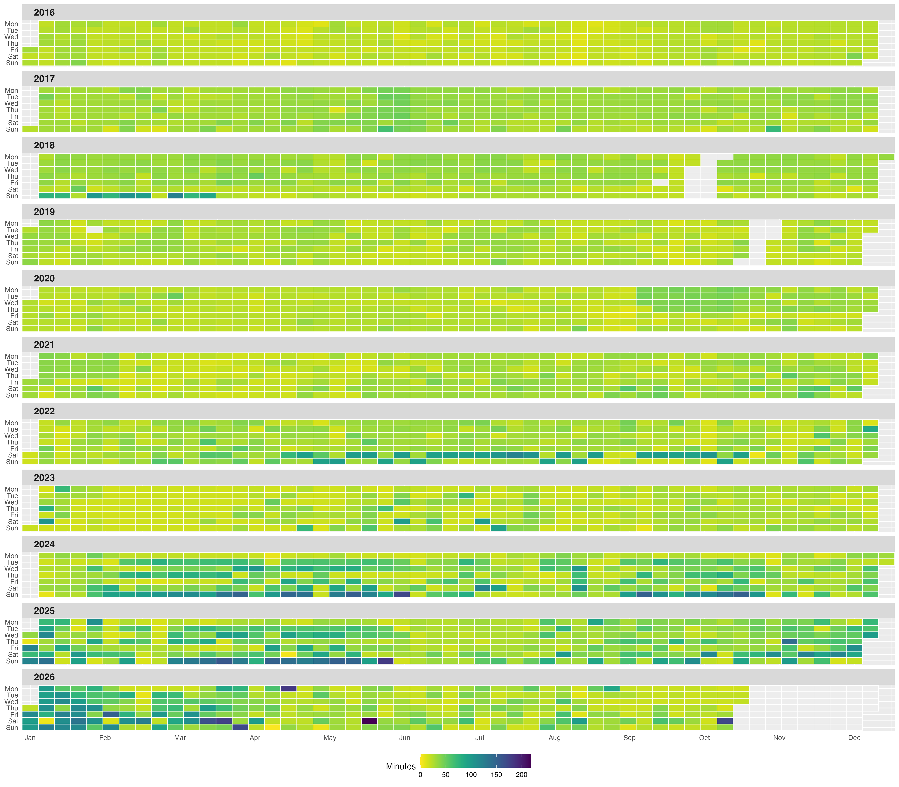
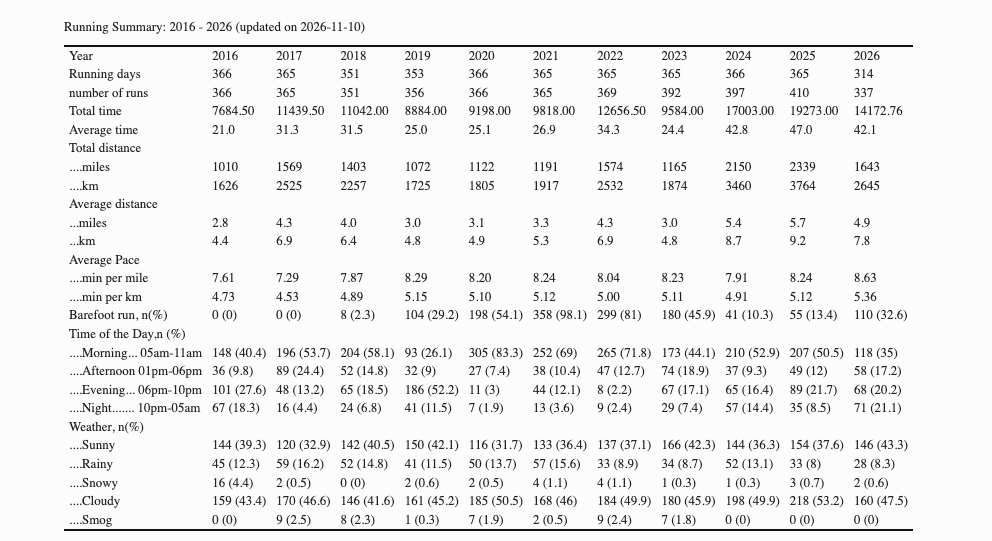

On 01-01-2016, I decided to run at least one mile a day every day for the rest of my life. 

And I keep a record here, as a method to keep myself motivated. I also write short posts weekly in Chinese to reflect on my running. [->Link to all my current posts<-](https://conge.github.io/category/#%E6%8A%98%E8%BF%94%E7%82%B9) and [my daily running page](https://conge.github.io/running_page/).

See my running records below:

[2016](https://github.com/conge/RunningStreak/blob/master/runningRecords2016.csv), [2017](https://github.com/conge/RunningStreak/blob/master/runningRecords2017.csv), [2018](https://github.com/conge/RunningStreak/blob/master/runningRecords2018.csv), [2018 Reload](https://github.com/conge/RunningStreak/blob/master/runningRecords2018_reload.csv), [2019](https://github.com/conge/RunningStreak/blob/master/runningRecords2019.csv), [2019_reload](https://github.com/conge/RunningStreak/blob/master/runningRecords2019_reload.csv),  [2020](https://github.com/conge/RunningStreak/blob/master/runningRecords2020.csv), [2021](https://github.com/conge/RunningStreak/blob/master/runningRecords2021.csv), [2022](https://github.com/conge/RunningStreak/blob/master/runningRecords2022.csv), [2023](https://github.com/conge/RunningStreak/blob/master/runningRecords2023.csv), [2024](https://github.com/conge/RunningStreak/blob/master/runningRecords2024.csv), [2025](https://github.com/conge/RunningStreak/blob/master/runningRecords2025.csv) and [2026](https://github.com/conge/RunningStreak/blob/master/runningRecords2026.csv).

My inspiration came from the [United States Running Streak Association, Inc.][1], although I am not a member but the Association are full of people who keep running as part of their daily routine.

### Visuals of my running history: 2016 - now



### Summary of my running history:



### Updating the records

One row per run in `runningRecords<year>.csv`, newest first, with every run on
the same day sharing a single streak number.

#### The daily row, by hand

1. After the run, take one photo at the return point and sync it from the
   phone to the computer (I go through OneNote).
2. Save that photo as `ReturnPoints/YYYYMMDD.webp` — longest side 1080 px,
   WebP quality ~80. `sips` cannot write WebP, so use the script below or any
   image converter.
3. Insert the row directly under the header, newest first:

   | streak# | date | startTime | runningTime(min) | Distance(mile) | Shoes | temperature(C) | weather |
   | --- | --- | --- | --- | --- | --- | --- | --- |
   | 2540 | 20261103 | 11:25 pm | 19.83 | 2.14 | SL2 | 06 | Cloudy |

   - `streak#` — previous day's number + 1; a second run on the same day reuses
     the same number.
   - `date` — `YYYYMMDD`, `startTime` — `hh:mm am/pm` (lower case, zero padded),
     `runningTime(min)` — minutes, `Distance(mile)` — two decimals.
   - The last three columns are not in any export and must be typed in:
     `Shoes` from what I wore, `temperature(C)` and `weather` from the hourly
     weather record of the hour I started.
4. Keep the file UTF-8 **with BOM** and LF line endings, otherwise the diff
   rewrites every line.

#### Catching up on several days at once

Date, start time, duration and distance can be pulled from the
[running_page](https://github.com/conge/running_page) activities feed, and
temperature/weather from the Open-Meteo historical archive:

```sh
python3 sync_runs.py --dry-run     # preview
python3 sync_runs.py               # append + refresh activities.json
```

It only appends runs newer than the last date in the CSV, continues the
streak numbering from the CSV itself (the upstream `streak` field numbers
differently) and leaves `Shoes` empty. Fill those in afterwards.

Return point photos are picked from the phone camera roll by matching the
photo time to the middle of a run, then converted to WebP:

```sh
python3 update_return_points.py --since 20260611 --dry-run
python3 update_return_points.py --since 20260611
```

Days with no photo near a run are listed at the end — those still need a hand.

Finally re-knit `Analysis/runningAnalysis2020.Rmd`: it reads every
`runningRecords*.csv` and rewrites `overview_plot.png` and
`yearly_overview.png`.

[1]:http://www.runeveryday.com
